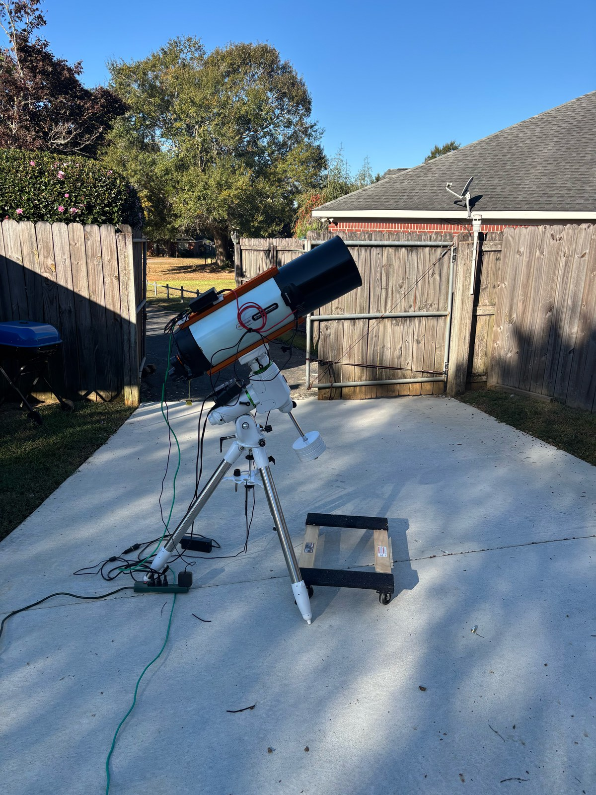

## Current rig: Celestron RASA 8

The replacement RASA 8 is the main imaging scope now. It is 400 mm at f/2, which is why a night of unguided 30-second subs can fill a frame from this backyard. The first unit went back to Celestron with an optical ghost on bright stars. This one arrived on October 28, 2026.

| Role | Gear |
|---|---|
| Telescope | Celestron RASA 8, 400 mm f/2 |
| Camera | ZWO ASI2600MC Pro (one-shot color) |
| Filter | Celestron 93619 Ha / Hβ / OIII, from the RASA kit |
| Focuser | Celestron focus motor |
| Mount | Sky-Watcher EQ6-R Pro |
| Guiding | Guide scope not mounted yet; being added soon. Currently unguided 30-second subs |
| Capture | NINA, running on a mini PC |
| Processing | PixInsight, Siril, GraXpert, and RC Astro |

## Other telescopes

- **Askar 71F** (490 mm, f/6.9): the previous main rig, and still in the rotation. It rides a Sky-Watcher Star Adventurer GTi, guided with PHD2 and an SVBONY SV165 guide scope plus SV905C camera. Same ASI2600MC Pro as the RASA.
- **Celestron EdgeHD 8:** in Hank's shop, visual use only for now. It needs a guiding setup before it can be used for astrophotography. It uses a Celestron focus motor, like the RASA.

## Filters

The RASA shoots through the Celestron 93619 tri-band filter that came with the kit. None for the Askar yet.

## Also in the bag

A Nikon D5600 with a 70-300 mm lens, used handheld for the Moon.

## Conditions

Backyard imaging on the Gulf Coast near Mobile, Alabama: Bortle 6, humid air, and a few well-placed trees.
