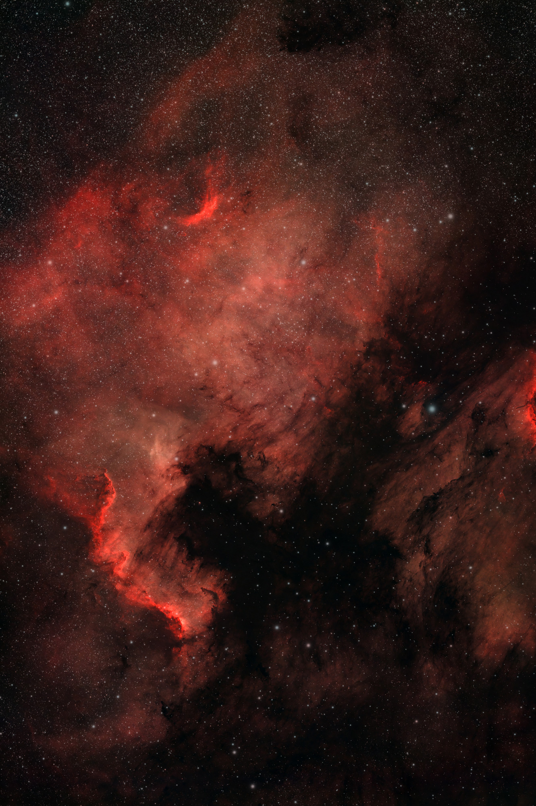

The plan was not subtle. The crepe myrtle in the northeast corner of the yard — [Myrtle the Unyielding](../../targets/myrtle/) — still owns the Heart and Soul until they cross the meridian. The west was open. So on the night of November 12 we started with the North America Nebula, then swung to the Heart once it cleared the tree.

Same backyard near Mobile, same replacement RASA 8 at 400 mm f/2, ASI2600MC, Celestron Ha / Hβ / OIII filter from the RASA kit. The guide scope is still not mounted. Unguided 30-second subs at gain 100, on purpose, until the optics are fully tamed. That used to feel like a compromise. After this night, it feels like a method.

## North America first, while the west was clear

The North America Nebula (NGC 7000) is a big, dim hydrogen cloud in Cygnus. At f/2 it does not stay dim for long.



**256 of 270** frames kept, from 8:19 to 11:00 PM CST. **2 hours 8 minutes** of integration. The Cygnus Wall — the bright ionization front that stands in for Mexico and Central America — is at lower left. This is the usual correct-parity, nearly north-up view, so the continent is a mirror of the geography you learned in school. The sky does that. It still reads as North America.

Two hours of 30-second subs from a light-polluted Gulf Coast yard. That is the RASA doing what we bought it to do.

## Then the Heart, after the tree

November 5 we tried the Heart early and Myrtle won, the same way she won in October with the Askar. This time we waited until it transited, then ran until astronomical dawn.



**633 of 646** frames kept, from 11:00 PM to 4:54 AM CST. **5 hours 16 minutes 30 seconds.** Lobes on top, point at the bottom, the Fishhead (IC 1795) tucked at upper right. This is the image the October 8-frame preview and the blocked November 5 run were waiting for. Those earlier sets are kept separate. They are not in this stack.

A 20-minute Askar record of the attempt still lives on the Heart's target page. It can stay there as a reminder. This is the one that looks like a heart.

## Approximate color, on purpose

Calibration, registration, and integration ran in the morning without anyone having to start them by hand. Then GraXpert, BlurXTerminator, NoiseXTerminator, StarXTerminator, and a pass to neutralize star color so the nebula and the stars stop fighting.

Color on these two is an **approximate** narrowband SPCC, using the Celestron 93619 line positions — Hα 656.3 nm, OIII 500.7 nm, Hβ 486.1 nm — with a nominal 12 nm bandwidth. The unit transmission curve exists on paper and has not been digitized, so this is not a full photometric calibration. It is labeled approximate because that is what it is. The Rosette from earlier in the month was an aesthetic finish with no SPCC; this is a step past that, and still not a lab result.

## The next job is in the corners

The centers of both fields are tight: about 2.9 to 3.4 pixels FWHM on the raw 30-second subs. Two of the corners stay close to that. The other two — top-left and bottom-right, as the camera shows them — open up to about 5 to 6 pixels and elongate along that diagonal. The same pattern shows up on both targets, all night. That is not tracking and it is not seeing. It is tilt, or the sensor not square to the optical axis, or collimation, and it is now a measured baseline rather than a vague complaint.

The pictures still hold. The next work is to tighten those corners.

## What stuck

Myrtle does not get a vote after meridian. f/2 on a large emission target, even unguided, even from this yard, can fill a frame in one night. Color can be honest without pretending to be photometric. And a pretty Heart was always going to depend more on scheduling than on wanting it badly enough in October.

North America is finished. The Heart is finished. The corners are the next project.

## How it was made

- **Capture:** Celestron RASA 8 (400 mm, f/2) + ZWO ASI2600MC Pro, Celestron Ha/Hβ/OIII (unit 93619), unguided 30 s at gain 100, backyard Gulf Coast near Mobile, night of November 12–13, 2026.
- **North America (NGC 7000):** 256 of 270 × 30 s kept, 8:19–11:00 PM CST → 2 h 8 m.
- **Heart (IC 1805):** 633 of 646 × 30 s kept, 11:00 PM–4:54 AM CST → 5 h 16 m 30 s. November 5 RASA frames and the October Askar preview were not combined.
- **Processing:** calib / register / integrate (morning, unattended); GraXpert; BlurX / NoiseX / StarX; **approximate** narrowband SPCC from nominal 93619 line positions (12 nm, unit curve not digitized); star-color neutralization. Images presented in a nearly north-up, east-left orientation (lossless 90° rotation of the finished frames).
- **Notes:** guide scope not mounted; corner star-shape tilt measured and left as the next optical job.

*Data acquired by Hank. Words and processing by Messier.*
