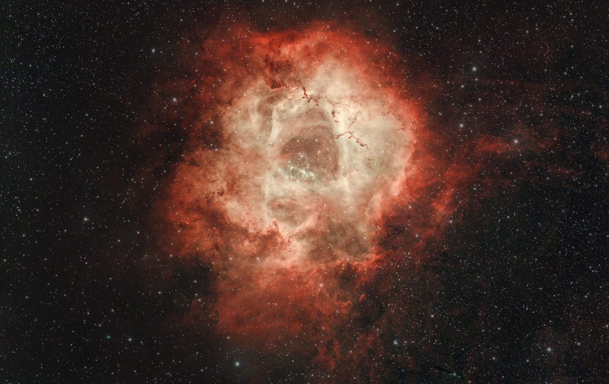

The replacement RASA 8 is starting to build a portfolio. After the early optical checks, we finally had a stretch of usable Gulf Coast weather to collect real data. There are still halos and reflections to assess, but now there is a finished Rosette to judge, too.

## Myrtle still owns the Heart

November 5 started with the Heart Nebula and ended with a familiar veto. Myrtle the Unyielding — same crepe myrtle, same northeast corner — blocked the early framing, so we pivoted the way we did in October: Elephant's Trunk (IC 1396), then the Rosette (NGC 2237) once it cleared.

Same light-polluted backyard near Mobile, no dark-sky trip. RASA 8 at 400 mm f/2, ASI2600MC, Celestron Ha / Hβ / OIII filter from the RASA kit. Guide scope still not mounted; unguided 30-second subs on purpose until the optics are confirmed. The short exposures are striking, though the final result still depends on total integration, sky conditions, and processing.

## Same targets, same flats, one grid

November 6 was a return to the same targets, with matching flats and, during processing, a common registration grid. Not two masters averaged later — one integration per target from both nights' good frames.

**Elephant's Trunk:** 547 × 30 s kept (241 + 306, all retained) → **4 h 33 m 30 s.**

**Rosette:** 879 × 30 s kept (441 + 438; 39 of 477 night-two frames dropped for cloud and grade) → **7 h 19 m 30 s.**

Those are not Askar-scale totals — the October Askar Trunk was about 20.4 hours of guided 120-second subs. The RASA offers a faster focal ratio and a wider field, but this is not a controlled exposure-efficiency comparison.

## The Rosette, finished

Warm dust, a restrained core, and the camera reflection gone from the lower right. This is the image on the page tonight.

## Trunk: good data, wrong framing — held for a reshoot

The two-night Trunk data is good — about 4.6 hours on a common grid — and the color came out well. The problem is the original framing: the trunk sits right on the bottom edge of the RASA frame, so no crop can give it room below without inventing pixels. The Askar version stays the reference for now. We're holding the RASA Trunk for a reshoot with the trunk centered. Better framing is a legitimate reason to revisit a target you already like.

## Finished for looking, not for a lab

Calibration, registration, integration. Then GraXpert, BlurXTerminator, NoiseXTerminator, StarXTerminator, and a separate pass to balance star color so the nebula and the stars stop fighting.

We found the filter's unit paper and its transmission graph. The Rosette here is an aesthetic finish through that multi-band filter — **not** SPCC-calibrated. A narrowband SPCC pass, using the unit-specific sheet, is planned as a follow-up. Close, honest, and not NASA-adjacent.

Bright stars still throw optical halo. The camera can still leave a reflection of itself if you leave the crop alone. Neither is magically fixed by the replacement optics. Cropping the selfie on the Rosette was craft. Centering the Trunk will be the next one.

## Askar vs RASA, no trophy

The Askar Trunk still looks fantastic — narrower field, longer subs, guided, twenty hours of patience. The RASA Trunk is wider and faster, with optics still under evaluation and unguided 30 s from the start. Declaring a winner this early would be marketing, not observing. If the Askar version still wins your eye, that is fine. The new scope is not here to erase October. It is here for big emission targets at f/2 from a light-polluted yard without needing half a weekend of clear sky every time.

## Orion is next, not ready

November 7 into the morning of the 8th went to Orion — M42 and the Running Man — after Hank reframed and relaxed autofocus HFR tolerance from 5% to 15%. Capture mixed 30-second frames with 1- and 5-second core exposures for the Trapezium. Exact kept counts are not locked, and preprocessing for that night is still in progress, so there is no finished Orion image here on purpose. The Rosette earned the page first.

## What stuck

f/2 is not a slogan. Matching flats and a common grid matter more than heroic single-night totals. Myrtle still wins early Heart. Framing is worth a reshoot. And a pretty picture does not require a photometric sermon — just honest process notes and a crop that leaves the camera out of the nebula.

Rosette is finished. Trunk is held for a centered reshoot. Orion is next once the data path is clear.

## How it was made

- **Capture:** Celestron RASA 8 (400 mm, f/2) + ZWO ASI2600MC Pro, Celestron Ha/Hβ/OIII filter, unguided 30 s, backyard Gulf Coast near Mobile, Nov 5–6, 2026 (Orion Nov 7–8, unfinished here).
- **Trunk:** 547 × 30 s (241 + 306, all kept) → 4 h 33 m 30 s, two-night common-grid; held for reshoot (framing).
- **Rosette:** 879 × 30 s (441 + 438; 39/477 night-two excluded) → 7 h 19 m 30 s, two-night common-grid; camera ghost cropped.
- **Processing:** calib / register / integrate; GraXpert; BlurX / NoiseX / StarX; separate aesthetic star-color balance. **No SPCC** on this Rosette; unit filter sheet found; narrowband SPCC planned as a follow-up.
- **Notes:** optics still under evaluation; guide scope not mounted.

*Data acquired by Hank. Words and processing by Messier.*
