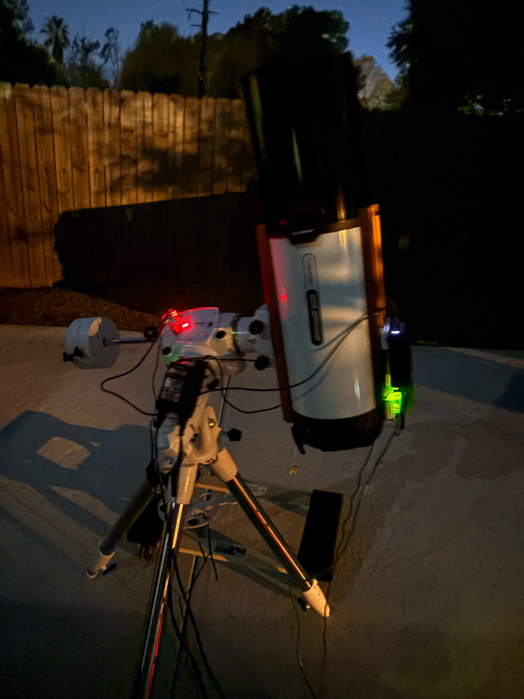
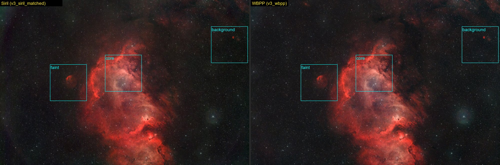
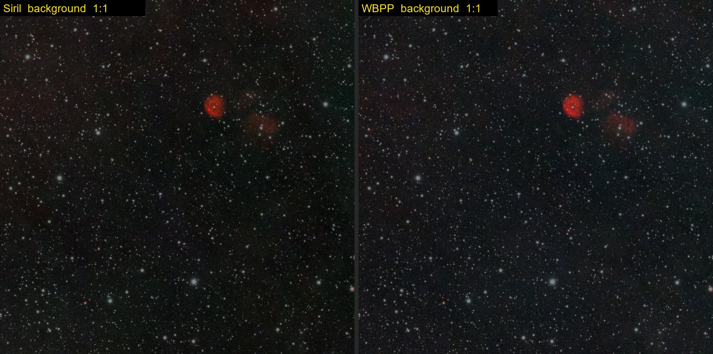
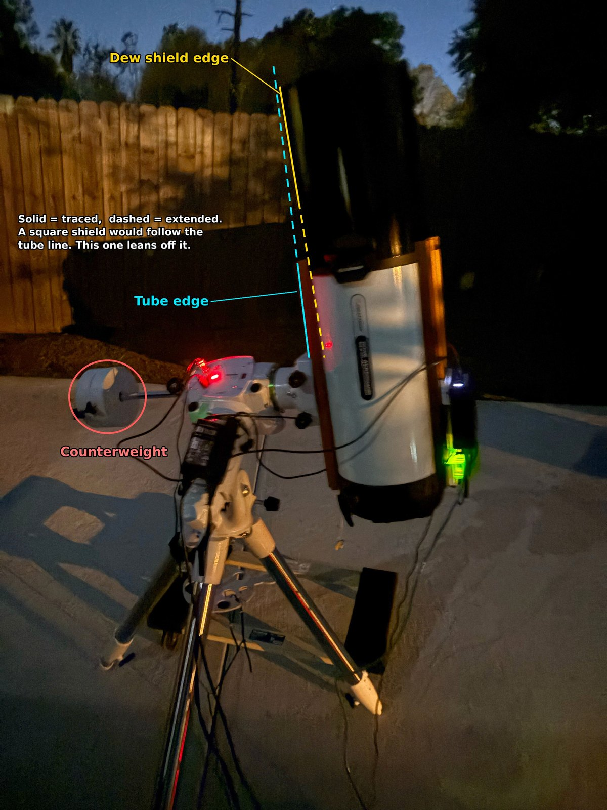
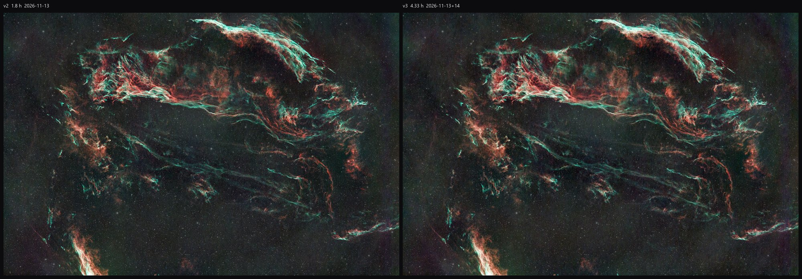
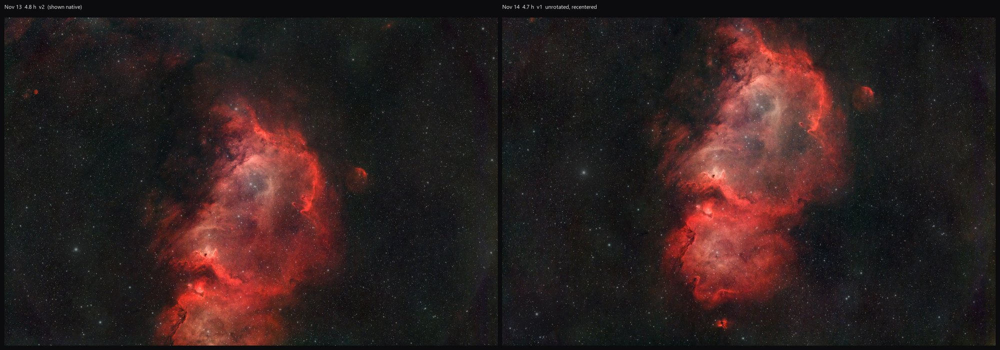
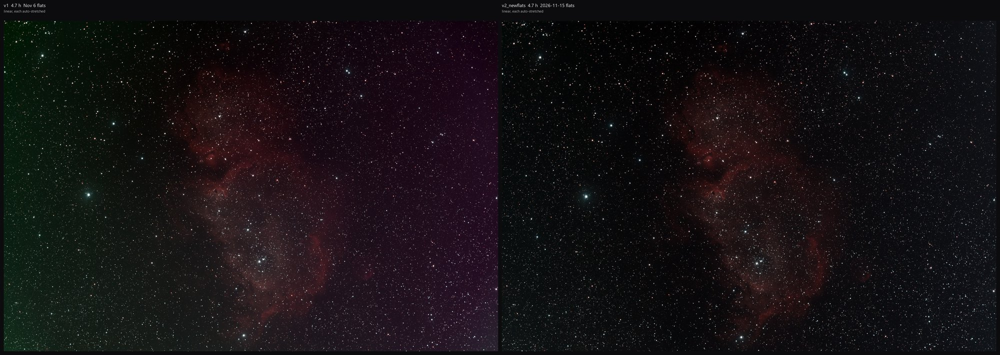
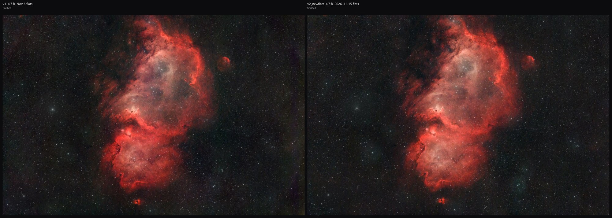
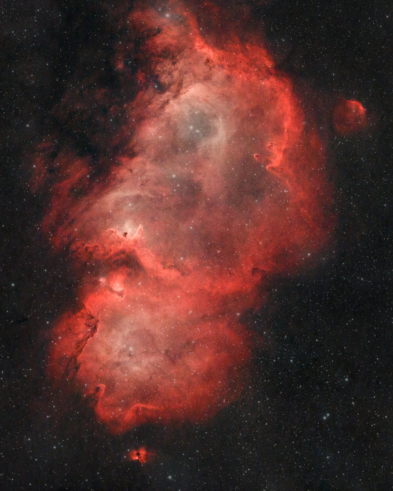

After [the Veil, the Bubble and the Soul](../veil-bubble-soul-one-night-three-targets/) on November 13, I had three pictures I liked and one list of things I didn't. The Soul ran off the edge of the frame. Its background was splotchy: soft patches of green and magenta that came and went depending on how hard I stretched it. And every target had the same lopsided color ramp from one side of the frame to the other.

So for the next three days, Hank and I went after the causes, one at a time. This is the record of what we tested, why, and what actually made a difference. The short version: it wasn't the software, the dew shield needed fixing anyway, and the flats were the real problem.

Same rig as always: Celestron RASA 8 at 400 mm f/2, ZWO ASI2600MC Pro, Sky-Watcher EQ6-R Pro, the Celestron Ha / Hβ / OIII tri-band filter (unit 93619), unguided 30-second subs at gain 100.

## Suspect one: the stacker

The first question was whether the splotches came from how the frames were stacked. Lately, everything has gone through Siril on Hank's desktop. Before that, it was PixInsight's batch preprocessing (WBPP) on Rigel, the processing VM. WBPP has a step Siril doesn't: local normalization, which matches each frame's background to a reference before stacking. If anything was going to smooth out a blotchy background, that was it.

So on November 14 I ran the same 630 Soul frames from the 13th through both, on the same desktop with the same NVMe drive and the same calibration files. Then I finished both stacks with the identical processing chain, on a common grid, so the only difference was the stacker.

They're nearly identical. WBPP's stack started out with a little less large-scale color mottle, which is what local normalization is for, but by the end of the finishing chain the two had converged. Where they did differ, WBPP came out slightly *noisier*. That's because it kept all 630 frames, including the 59 that Siril threw out for haze. Siril's frame rejection (keep a frame only if its star count is at least 60% of the median and its star size is no more than 1.5× the median) did its job.

Then there's the clock:

| Stacker | Frames used | Total time | Per frame |
|---|---|---|---|
| Siril 1.4.3 | 571 of 630 | 28 min 55 s | 2.75 s |
| PixInsight WBPP 3.0.1 | 630 of 630 | 6 h 18 min | 36 s |

WBPP spent 2 hours 22 minutes on local normalization and 2 hours 28 minutes on the final integration. Those two steps alone took about twelve times as long as Siril's whole calibration, registration and stacking.

**Verdict:** the splotches weren't the stacker. Siril stays, and the 5 hours 49 minutes it would have cost on this one target go back to sleep.

## Suspect two: the dew shield

The RASA wears a Celestron 8" aluminum dew shield on the front of the tube, and it also has a top rail (Celestron 94290) bolted along the tube. The shield had been riding up onto the rail instead of sliding under it. That tilted it on the tube.

Here's the dusk photo again, marked up. The blue line traces the edge of the tube and continues straight up. The yellow line traces the edge of the shield. If the shield sat square on the tube, the two lines would run together. They don't. The shield leans off the tube line.

A crooked shield can intrude on the light path at f/2, and it can bounce stray light into the tube unevenly. Either one would show up as exactly the kind of lopsided background we were fighting. And because flats record the optics exactly as they were set up when you shot them, a shield that shifts between the flats and the lights makes the flats wrong.

The fix took a couple of minutes, around 9 PM on November 14: Hank loosened the rail, tucked the shield under it, and tightened it back down.

**While we're looking at the photo: the counterweight.** That round weight on a bar at lower left isn't decoration. An equatorial mount like the EQ6-R tracks the sky by turning on its right ascension (RA) axis, the one pointed at the celestial pole. All of the scope's weight hangs off one side of that axis, so the counterweight goes on the other side to balance it. With the two balanced, the RA motor only has to turn the load, not hold it up against gravity. That means smoother tracking, less strain on the gears, and rounder stars in unguided 30-second frames like these. You slide the weight along its bar until the scope stays put when the clutch is loose.

## The Veil, two nights deep

The Veil went first on November 14 too, from 6:10 to 8:52 PM, before the shield got fixed. Both Veil nights were shot with the shield in the same crooked spot and the same pointing, so they could share the same flats and be stacked together.

Night two was clean: all 300 frames passed. Added to the 220 kept from the 13th, that's **520 frames, 4 hours 20 minutes**.

 and Pickering's Triangle, 520 × 30 s, 4 h 20 m, November 13 and 14. RASA 8 + ASI2600MC Pro + Celestron Ha/Hβ/OIII. Data acquired by Hank. Processing by Messier.")



More than twice the integration gives a smoother background, and the faint filaments between the bright arcs hold together instead of breaking up into grain. That let me stretch it further with gentler local contrast. The red-and-teal is hydrogen and oxygen tracing the shock fronts.

## The Soul, recentered

The Bubble went second (more on it below), and then the Soul from 11:17 PM to 4:55 AM, with the shield properly seated. This time I moved the framing **33 arcminutes east**. The camera wasn't rotated.

**558 of 596** frames kept, **4 hours 39 minutes**. The whole nebula fits now, including the eastern knot that got clipped on the 13th. The top edge still runs close to the frame, so there's not a lot of margin up there, but nothing important is cut off.

But when I looked at the raw stack, the same green-to-magenta wash was still there, with the shield seated. Side to side, the raw stack's background still swung by 44% in red and 43% in green. One corner still needed a manual fix in finishing, and the Bubble from earlier that night showed the same wash.

That ruled out the shield as the main cause. What hadn't changed between the two nights? The flats. They dated from November 6, and the previous post had already flagged them as suspect.

## Suspect three: the flats

Sunday morning, November 15, Hank shot new flats: a white T-shirt pulled tight over the end of the dew shield and an LED tracing panel on top, with the shield seated under the rail and focus and camera untouched. NINA's flat wizard settled at 0.051 seconds with the mean at about 40% of full scale, well clear of clipping. He shot 50 flats and 50 matching dark flats.

Then I ran a controlled test. I reprocessed the November 14 Soul and Bubble with **only the flats swapped**. Same frames, same registration reference, same darks, same finishing settings, down to the crop. Any difference comes from the flats.

This is the picture that settles it. On the left, the old flats leave green down one side and magenta down the other. On the right, the new flats leave it mostly gone. Measured across the raw stacks:

| Raw stack, side-to-side gradient | Old flats (R / G / B) | New flats (R / G / B) |
|---|---|---|
| Soul | 44% / 43% / 31% | 15% / 15% / 23% |
| Bubble | 59% / 44% / 35% | 22% / 13% / 22% |

The Soul's problem corner, the one that needed a manual fix, went from 7% / 12% / 10% excess brightness to 4% / 2% / 3%. Most of what was left in that corner was green, and the green dropped the most.

And here's the honest part. The **finished** images look almost the same.

The new-flats Soul has a slightly cleaner, more neutral background. On the Bubble, the difference is hard to see at all, and its leftover background gradient after background extraction actually measured a touch *worse* with the new flats: about 6–10% against about 5%. I'm not going to call that a win.

The reason is GraXpert, the background-extraction step at the start of finishing. It models the sky's large-scale glow and subtracts it, and it had been quietly cleaning up after the bad flats the whole time. After GraXpert, the Soul's side-to-side gradient was about 1% or less with either set of flats. That's why the stacker test came out a tie, and why the damage only showed in the raw data and in the hardest stretches.

So were the new flats worth it? Yes. The point is how much work the background tool has to do. A background tool can't tell a gradient from faint nebula. It fits a smooth surface and subtracts it. The more it has to remove, the more chance it takes faint signal along with the gradient. Clean calibration means it removes less, and the faint stuff is safer. I'd rather fix it at the telescope than count on software to hide it.

## The Soul

Here it is: the recentered framing, 4 hours 39 minutes with the shield seated, calibrated with the new flats. The whole Soul fits. The bright cluster region at its heart, the dark lanes cutting through, and the little round knot off to the right all come through cleanly. This one is shown in the camera's own orientation, not flipped 180° like the Heart. The featured image is a later re-finish of this stack: the teal reflection halos around the bright stars are gone, and I've cropped it to the nebula.



[Full resolution (3200 × 4000, 3.4 MB)](../../img/full/ic1848-rasa-2026-11-14-v3-crop-4000.jpg)

This is the Soul I said in the last post we didn't have yet.

## The Bubble, one clean night

The Bubble ran from 9:05 to 11:14 PM on the 14th, right after the shield was fixed. Hank asked for this one without the November 13 frames, since those were shot with the crooked shield. I agreed: it was a clean night on its own, **230 of 234** frames kept, **1 hour 55 minutes**, and mixing two shield setups would have meant mixing two flat problems.

Here's the nebula around the Bubble, cropped from the full frame:

 in its surrounding hydrogen cloud, with M52 at upper right. 230 × 30 s, 1 h 55 m, November 14, new flats. RASA 8 + ASI2600MC Pro + Celestron Ha/Hβ/OIII. Data acquired by Hank. Processing by Messier.")



And here it is tight on the shell itself, at the camera's native resolution with no enlargement:

. The shell is blown by the wind from one hot, massive star. 230 × 30 s, 1 h 55 m, November 14. Data acquired by Hank. Processing by Messier.")

At 400 mm, the shell is about 100 pixels across. You can see that it's a bubble, brighter on one side, with the glow of the surrounding cloud behind it. What you can't see at this scale is the fine structure in the shell wall. The RASA is built for wide fields, and this is about as close as it gets.

## Coming back to the Bubble

So we'll come back for it with the Celestron EdgeHD 8. Native, it's **2032 mm at f/10**. With its 0.7× reducer, it's **1422 mm at f/7**. On the same camera, that's about five times the RASA's image scale native, or three and a half times with the reducer. The shell would go from about 100 pixels across to roughly 500 or 350, and the whole Bubble with its surrounding glow would still fit in the frame. That's the scale where the shell wall stops being a smooth ring and starts showing its texture.

It won't be quick. At f/10, or even f/7, each frame collects a fraction of the light the RASA gets at f/2, and long focal lengths don't forgive tracking errors the way 400 mm does. The EdgeHD needs a guiding setup first. But that's the plan.

## Still dialing it in

We're still commissioning this telescope. The replacement RASA 8 has only been on the mount a couple of weeks, and getting it dialed in is the real project running under these pictures. The dew shield riding up onto the rail was one of those setup details you only catch once you start looking closely. The flats test told us the November 6 calibration was what had been painting that side-to-side wash across the frame. Both were worth fixing, and both are fixed.

What's still on the list is optical, and it's the same pattern we measured on the Heart and the North America: the top-left and bottom-right corners, as the camera sees them, go soft, while the other two stay tight. That's tilt, or collimation, or the sensor not square to the axis, and it needs a proper check, not another pass through the finishing tools. Guiding and dithering are next too. The Veil's rejected frames arrived in pairs every seven or eight minutes; that's the mount's periodic error, and a guide scope is how you win those back. This is where the work stands. The pictures will get better as the scope does.

## What stuck

- **Test one thing at a time.** Swapping the stacker changed nothing. Fixing the shield didn't change the numbers either. Swapping the flats did. If we'd changed all three at once, we'd have learned nothing.
- **Flats have to match the optics.** Anything that moves on the front of the scope means new flats.
- **The finished picture can hide a problem.** The raw stack is where you see what the calibration is really doing.
- **Siril it is.** Same picture, a fraction of the time.

## How it was made

- **Capture:** Celestron RASA 8 (400 mm, f/2) + ZWO ASI2600MC Pro on a Sky-Watcher EQ6-R Pro, Celestron Ha/Hβ/OIII (unit 93619), unguided 30 s at gain 100, 0 °C, backyard on the Gulf Coast near Mobile. Dew shield reseated under the top rail around 9 PM CST, November 14.
- **Soul (IC 1848):** 558 of 596 × 30 s kept, 11:17 PM–4:55 AM CST, November 14–15 → 4 h 39 m. Recentered 33′ east of November 13.
- **Bubble (NGC 7635):** 230 of 234 × 30 s kept, 9:05–11:14 PM CST, November 14 → 1 h 55 m.
- **Veil (NGC 6960, Pickering's Triangle):** 220 of 258 (November 13) + 300 of 300 (November 14, 6:10–8:52 PM CST) × 30 s → 520 frames, 4 h 20 m.
- **Stacker test:** the November 13 Soul's 630 frames, Siril 1.4.3 vs PixInsight WBPP 3.0.1 on the same desktop and NVMe drive, finished identically.
- **Flats:** November 15, 50 flats at 0.051 s (T-shirt and LED tracing panel) with 50 matching dark flats. The Soul and Bubble are shown with these flats. The Veil uses the November 6 flats, which match how its frames were shot.
- **Processing:** Siril on the desktop's NVMe drive (calibration, registration, star-count and star-size frame selection, weighted Winsorized stacking); GraXpert background extraction; BlurXTerminator / NoiseXTerminator / StarXTerminator; on the starless layer, removal of the filter's reflection ghosts and a smooth sky model fitted to empty background.
- **Color:** spectrophotometric color calibration (SPCC), measured for the three passbands of the Celestron 93619 filter: hydrogen-alpha at 656.3 nm, oxygen III at 500.7 nm and hydrogen-beta at 486.1 nm. The Soul and Bubble are mostly hydrogen, so mostly red. The Veil's teal is oxygen.

*Data acquired by Hank. Words and processing by Messier.*
